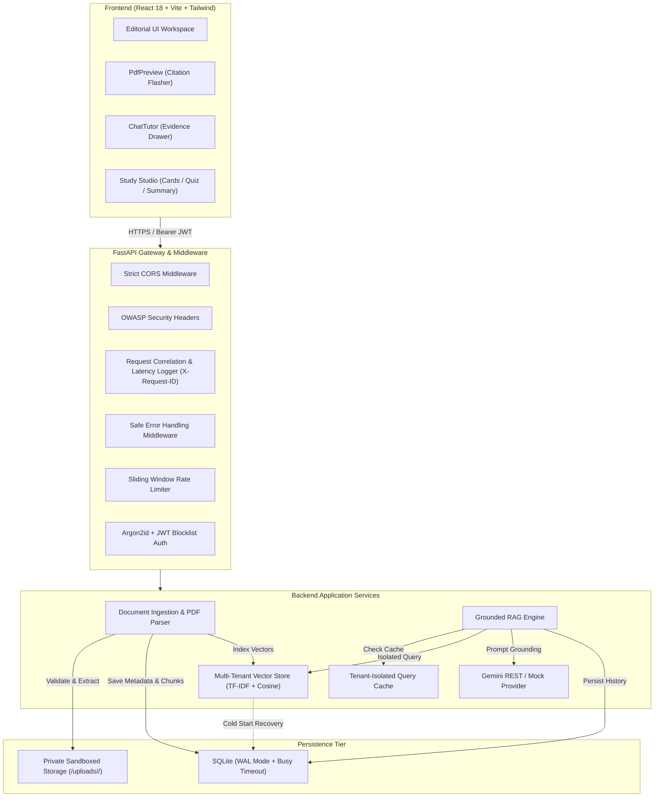

<div align="center">

# 📚 StudyLens AI — Your Personal PDF Tutor
### Grounded Academic Tutoring with Verifiable Page Citations, Multi-Tenant Isolation & Active Recall Studios

[](https://www.python.org/)
[](https://fastapi.tiangolo.com/)
[](https://react.dev/)
[](https://vitejs.dev/)
[](https://tailwindcss.com/)
[](LICENSE)
[](docs/SECURITY.md)
[-brightgreen?style=for-the-badge)](docs/TESTING.md)

<p align="center">
  <b>A production-grade, editorial AI tutor that turns dense textbooks, lecture notes, and scientific research papers into interactive study environments with verifiable page citations, multi-tenant data isolation, 3D active recall flashcard studios, and practice exams.</b>
</p>

[Key Features](#-key-features) • [Architecture](#-architecture) • [Getting Started](#-getting-started) • [Running Tests](#-running-tests--security-gates) • [Documentation Index](#-complete-documentation-index) • [License](#-license)

---

</div>

## 📖 Overview

Students face severe cognitive overload when digesting complex textbooks and research materials. Generic AI chatbots frequently hallucinate facts, fail to reference source passages, and present significant privacy vulnerabilities when private academic notes are commingled.

**StudyLens AI** solves this with a **grounded RAG tutoring engine**:
1. **Verifiable Page Citations:** Every answer cites source pages like `[Page 3]`. Clicking any citation instantly navigates the side-by-side Document Viewer to the exact page and triggers a `.citation-flash` animation over the cited excerpt.
2. **Server-Side Citation Validation:** Model citations are verified against chunks *actually retrieved* for the request. Fabricated page numbers are rejected.
3. **Multi-Tenant Isolation (Zero IDOR / BOLA):** User A can never view, download, chat with, or delete User B's documents or vectors. Every database query, vector search, and file retrieval is strictly scoped to the authenticated `user_id`.
4. **Interactive Study Tools:** Instant generation of executive summaries, active recall flashcards with 3D flip card physics, and multiple-choice practice quizzes with immediate feedback and page explanations.
5. **Calm Editorial SaaS Aesthetic:** Designed for extended studying with warm paper canvases (`#F8F7F4`), Newsreader serif for scholarly reading, Inter for crisp UI controls, and JetBrains Mono for page badges.

---

## ✨ Key Features

| Feature | Description |
| :--- | :--- |
| **🤖 Grounded AI Tutor Chat** | Chat with your PDF. The tutor answers solely using verified passages and deflects prompt injections. |
| **📄 Page-Aware PDF Viewer** | Split-screen reader showing page passages with typography scaling (`A`/`A+`) and citation flash highlights. |
| **🔍 Citation Verification Layer** | Server-side validation confirming citations match retrieved passages, preventing AI hallucinations. |
| **⚡ 3D Flashcard Studio** | Active recall cards with 3D flip animations, mastery tracking, and desktop keyboard shortcuts (`Space`, `Arrows`, `M`). |
| **📝 Practice Quiz & Self-Assessment**| Multiple-choice questions with instant scoring, feedback, explanations, and page citations. |
| **🛡️ Defense-in-Depth Security** | Argon2id password hashing, token revocation blocklists, sliding-window rate limiters, and CSP headers. |
| **⚡ High-Concurrency Backend** | SQLite WAL mode with 30s busy timeout, vector store cold-start recovery, and tenant-isolated query cache. |

---

## 🏗️ Architecture



For complete architecture details, see [docs/ARCHITECTURE.md](docs/ARCHITECTURE.md).

---

## 🚀 Getting Started

### Prerequisites
- **Python**: 3.11+ (Tested on 3.13)
- **Node.js**: v18+ (Tested on v20/v24)
- **npm**: v9+

### 1. Clone & Environment Setup
```bash
git clone https://github.com/<your-username>/StudyLens-AI.git
cd "StudyLens AI"

# Copy environment template
cp .env.example .env
```

### 2. Backend Setup
```powershell
# Windows
python -m venv .venv
.\.venv\Scripts\Activate.ps1
.\.venv\Scripts\pip install -r backend/requirements.txt
.\.venv\Scripts\python -m uvicorn backend.app.main:app --port 8000 --reload

# Linux / macOS
python3 -m venv .venv
source .venv/bin/activate
pip install -r backend/requirements.txt
python -m uvicorn backend.app.main:app --port 8000 --reload
```
The backend API starts on `http://127.0.0.1:8000`. Interactive OpenAPI documentation is accessible at `http://127.0.0.1:8000/docs`.

### 3. Frontend Setup
In a separate terminal window:
```bash
cd frontend
npm install
npm run dev
```
Open `http://localhost:5173` in your web browser.

---

## 🧪 Running Tests & Security Gates

StudyLens AI enforces strict release gates. Run the complete automated verification suite with a single command:

```powershell
# Windows
.\.venv\Scripts\python run_all_tests.py

# Linux / macOS
python run_all_tests.py
```

### Release Gate Status

```
======================================================================
 StudyLens AI - Comprehensive Security & Quality Release Gates
======================================================================
[v] Secret & IP Protection Scan                  : PASS (0 leaks)
[v] Bandit Python SAST Analysis                  : PASS (0 vulnerabilities)
[v] Pytest Unit & Security Test Suite            : PASS (27 passed / 0 failed)
[v] Frontend Build & Type Check                  : PASS (0 build errors)
----------------------------------------------------------------------
[SUCCESS] All mandatory release gates PASSED! Application verified for release.
```

### Running the Concurrency Benchmark
```powershell
.\.venv\Scripts\python backend/tests/load_test_runner.py
```
**Empirical Benchmark Performance:**
- **Smoke Test (2 VUs)**: 84.61 RPS | p50 = 23.02 ms | p95 = 42.32 ms | 0.0% errors
- **Baseline Load (10 VUs)**: 97.18 RPS | p50 = 97.10 ms | p95 = 157.29 ms | 0.0% errors
- **Moderate Load (25 VUs)**: 97.80 RPS | p50 = 246.84 ms | p95 = 349.87 ms | 0.0% errors

---

## 📚 Complete Documentation Index

All technical documentation is located in the [`docs/`](docs/) directory:

| Document | Description |
| :--- | :--- |
| [**Project Overview**](docs/PROJECT_OVERVIEW.md) | Vision, target audience, core personas, problems solved, and scope. |
| [**System Architecture**](docs/ARCHITECTURE.md) | System components, request lifecycles, sequence diagrams, and trade-offs. |
| [**Technology Stack**](docs/TECH_STACK.md) | Detailed inventory of frameworks, versions, libraries, and rationales. |
| [**Setup & Installation**](docs/SETUP.md) | Step-by-step setup guides for Windows, macOS, and Linux with troubleshooting. |
| [**Environment Variables**](docs/ENVIRONMENT_VARIABLES.md) | Full reference for all configuration options and secret management. |
| [**REST API Reference**](docs/API.md) | Endpoint specifications, authentication, schemas, and example payloads. |
| [**Database Architecture**](docs/DATABASE.md) | ER diagram, tables, indexes, WAL concurrency tuning, and backup runbooks. |
| [**AI & RAG Pipeline**](docs/AI_AND_RAG_PIPELINE.md) | Page chunking, vector math, XML prompt grounding, and citation validation. |
| [**Security & Threat Model**](docs/SECURITY.md) | Defense-in-depth, Argon2id, IDOR mitigation, upload sandboxing, and SAST. |
| [**Scalability & Performance**](docs/SCALABILITY_AND_PERFORMANCE.md) | Bottlenecks identified, implemented optimizations, and scaling roadmap. |
| [**Load Testing Report**](docs/LOAD_TESTING.md) | Concurrency benchmark methodology, stages, latency distributions, and RPS. |
| [**Production Deployment**](docs/DEPLOYMENT.md) | Dockerfile, docker-compose, Nginx reverse proxy, SSL, and rollback strategy. |
| [**Monitoring & Troubleshooting**](docs/MONITORING_AND_TROUBLESHOOTING.md) | Health checks, correlation ID tracing, error runbooks, and useful commands. |
| [**Testing & QA Guide**](docs/TESTING.md) | 27 automated tests breakdown, categories, commands, and verification gates. |
| [**Product Roadmap**](docs/ROADMAP.md) | Completed v1.0 capabilities vs scheduled v1.1, v1.2, and v2.0 features. |
| [**Developer Guide**](docs/DEVELOPMENT_GUIDE.md) | Codebase tour, directory layout, and step-by-step feature addition tutorials. |

---

## 🔒 Security Policy & Reporting

StudyLens AI adheres to responsible disclosure principles. If you discover a potential vulnerability:
1. Do NOT open a public GitHub issue.
2. Review our [Security Policy](docs/SECURITY.md).
3. Report the issue privately to the project maintainers.

---

## 📄 License & Intellectual Property

Copyright © 2026 Vatsal Patel. All Rights Reserved.

This project is protected by copyright law and licensed under a **Proprietary — All Rights Reserved** license. No permission is granted to copy, reproduce, distribute, sublicense, modify, or commercially exploit this software without the prior explicit written permission of Vatsal Patel. See the [LICENSE](LICENSE) file for complete legal terms. Third-party libraries remain governed by their respective open-source licenses.
