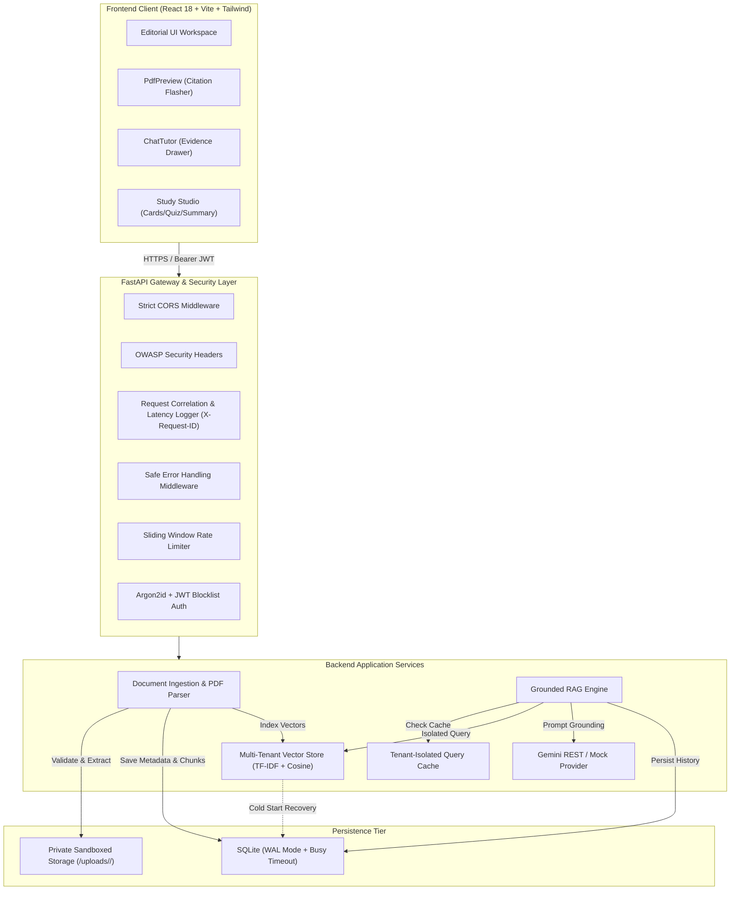
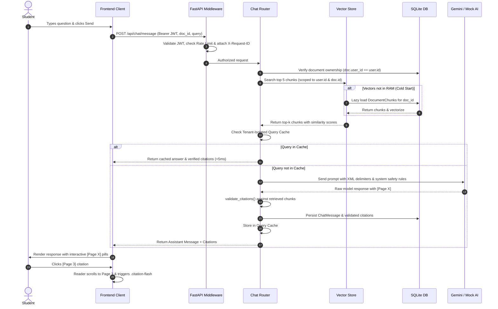

# StudyLens AI — System Architecture

## 1. Architectural Overview

StudyLens AI is architected as a decoupled, multi-tenant academic tutoring platform with a strict separation between client presentation, API gateway middleware, persistent storage, and the retrieval-augmented generation (RAG) engine.

---

## 2. Component Responsibilities

### Frontend Layer (`frontend/src/`)
- **Presentation & Typography**: Editorial reading environment built with Tailwind CSS, utilizing `Newsreader` for reading passages, `Inter` for controls, and `JetBrains Mono` for metadata tokens.
- **State Management**: Reactive React state managing active document selection, current study mode (`chat`, `summary`, `flashcards`, `quiz`), and citation page targeting (`targetPage`).
- **Citation Synchronization**: Clicking any `[Page X]` citation triggers a focus event on `PdfPreview`, smoothly navigating to the target page and triggering the CSS `.citation-flash` animation.

### API Gateway & Security Layer (`backend/app/middleware.py`, `backend/app/security.py`)
- **Correlation IDs**: Generates or forwards `X-Request-ID` across every HTTP request for distributed tracing and performance logging.
- **OWASP Headers**: Enforces strict Content Security Policy, X-Frame-Options (`DENY`), X-Content-Type-Options (`nosniff`), and HSTS.
- **Safe Error Shield**: Catches unhandled exceptions, logs detailed traces with correlation IDs on the server, and returns sanitized generic errors to clients to prevent internal path and schema leakages.
- **Sliding-Window Rate Limiter**: Thread-safe in-memory rate limiter protecting authentication (`5 req/min`), document upload (`10 req/min`), and chat queries (`30 req/min`).

### Document Ingestion Pipeline (`backend/app/pdf_processor.py`)
- **Untrusted File Validation**: Validates the `%PDF-` magic-bytes signature in the first 1024 bytes and enforces a 20 MB size limit and a 100-page DoS cap.
- **Page-Aware Text Chunking**: Extracts text page-by-page using PyPDF and segments text into sliding window chunks (800 characters with 150-character overlap) while preserving exact page provenance.
- **Storage Sandboxing**: Writes files using random UUID filenames in user-isolated directories (`backend/storage/uploads/<user_id>/<doc_id>.pdf`), verifying resolved paths to prevent directory traversal.
- **Bounded Concurrency**: Uses an `asyncio.Semaphore` (configurable via `MAX_CONCURRENT_UPLOADS=5`) to prevent CPU/memory spikes during simultaneous large uploads.

### Vector Search & RAG Retrieval (`backend/app/vector_store.py`, `backend/app/rag_engine.py`)
- **Tenant-Isolated Vector Store**: In-memory sparse vector engine utilizing sublinear term-frequency vectors and cosine similarity. Retrieval strictly requires matching `user_id`.
- **Cold-Start Durability**: If the server restarts and in-memory vectors are cleared, `ensure_document_indexed()` lazily loads and vectorizes chunks from the SQLite database on first access.
- **Query Cache**: Caches identical questions per `(user_id, document_id, normalized_query)` for 10 minutes, eliminating redundant LLM API calls and providing sub-5ms responses on repeated queries.
- **Prompt Injection Delimiters**: Formats retrieved passages inside XML delimiters (`<document_excerpt page="X">...</document_excerpt>`), treating document content as inert text and instructing the tutor never to execute embedded commands.
- **Server-Side Citation Validation**: Parses all model citations (e.g. `[Page X]`) and validates that the cited page corresponds to a chunk that was *actually retrieved* for that request. Fabricated citations are rejected.

---

## 3. End-to-End Request Lifecycles

### Complete Study Q&A Request Flow

---

## 4. Key Architectural Decisions & Trade-offs

| Decision | Alternative Considered | Rationale & Trade-off |
| :--- | :--- | :--- |
| **SQLite in WAL Mode** | PostgreSQL / MySQL | Zero external dependencies for local setup; WAL mode with 30s busy timeout and `synchronous=NORMAL` easily supports 100+ requests/sec on local storage. Clear migration path to Postgres for distributed multi-node clusters. |
| **In-Memory Normalized TF Vector Store** | ChromaDB / Milvus | ChromaDB has heavy binary dependencies (C++ build tools) that frequently fail on Windows. The in-memory sparse vector engine is fast, deterministic, self-contained, and has 0 external native dependencies. |
| **Cold-Start Lazy Indexing** | Persistent Chroma SQLite | By keeping SQLite as the single source of truth for chunks and lazily vectorizing on first search, the vector store survives application restarts without vector database sync corruption. |
| **Synchronous Grounding with Cache** | Asynchronous Celery Worker | Academic questions require immediate interactive answers. Bounded concurrency (semaphore) plus the in-memory query cache delivers instant responses without complex message broker infrastructure. |
| **XML Delimited Context** | Raw string concatenation | Protects against indirect prompt injection where adversarial text inside student PDFs attempts to override system tutoring guidelines. |

---

## 5. Related Documentation
- [AI & RAG Pipeline Details](AI_AND_RAG_PIPELINE.md)
- [Database Models & Indexing](DATABASE.md)
- [Security & Threat Model](SECURITY.md)
- [Scalability & Concurrency Analysis](SCALABILITY_AND_PERFORMANCE.md)
