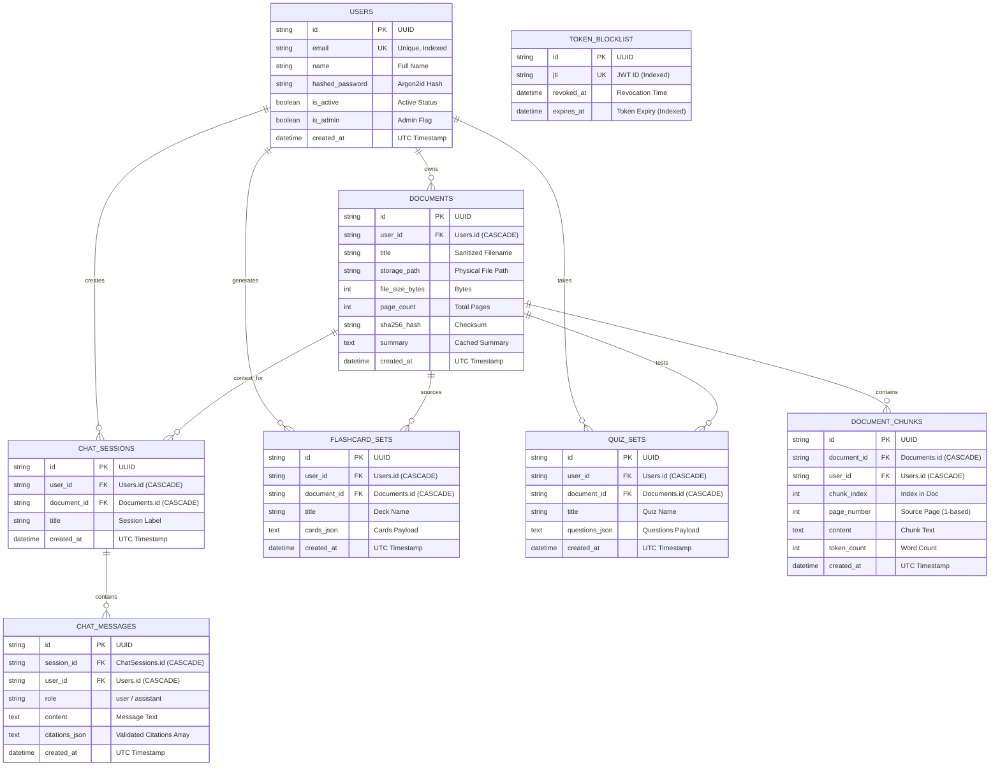

# StudyLens AI — Database Architecture & Schema Reference

StudyLens AI uses SQLAlchemy 2.0 with an SQLite relational database optimized for high-concurrency read/write operations via Write-Ahead Logging (WAL). This document provides the database schema, entity-relationship diagrams, index design, and operational procedures.

---

## 1. Entity-Relationship (ER) Diagram



---

## 2. Table Schemas & Index Strategy

### Table: `users`
Stores user identities and credentials.
- `id`: `String(36)`, Primary Key.
- `email`: `String(255)`, Unique, Indexed (`ix_users_email`).
- `name`: `String(255)`, Not Null.
- `hashed_password`: `String(255)`, Not Null (Argon2id encoded hash).
- `is_active`: `Boolean`, Default `True`.
- `is_admin`: `Boolean`, Default `False`.
- `created_at`: `DateTime(timezone=True)`, Not Null.

### Table: `documents`
Stores document metadata and physical storage pointers.
- `id`: `String(36)`, Primary Key.
- `user_id`: `String(36)`, Foreign Key (`users.id` ON DELETE CASCADE), Indexed.
- `title`: `String(255)`, Not Null.
- `storage_path`: `String(512)`, Not Null.
- `file_size_bytes`: `Integer`, Not Null.
- `page_count`: `Integer`, Not Null.
- `sha256_hash`: `String(64)`, Not Null.
- `summary`: `Text`, Nullable.
- `created_at`: `DateTime(timezone=True)`, Not Null.
- **Indexes**:
  - `ix_documents_user_id` on `user_id`.
  - `ix_documents_user_created` composite index on `(user_id, created_at)` for sorted library listings.

### Table: `document_chunks`
Stores segmented page-aware text chunks used for vector indexing and citation verification.
- `id`: `String(36)`, Primary Key.
- `document_id`: `String(36)`, Foreign Key (`documents.id` ON DELETE CASCADE), Indexed.
- `user_id`: `String(36)`, Foreign Key (`users.id` ON DELETE CASCADE), Indexed.
- `chunk_index`: `Integer`, Not Null.
- `page_number`: `Integer`, Not Null.
- `content`: `Text`, Not Null.
- `token_count`: `Integer`, Default 0.
- `created_at`: `DateTime(timezone=True)`, Not Null.
- **Indexes**:
  - `ix_chunks_doc_chunk_idx` composite index on `(document_id, chunk_index)`.
  - `ix_chunks_user_doc` composite index on `(user_id, document_id)` for tenant-isolated lookups.

### Table: `chat_sessions` & `chat_messages`
Stores student tutoring conversations and citations.
- `citations_json`: Serialized JSON array of validated `{chunk_id, page_number, snippet}`.

### Table: `token_blocklist`
Implements logout token invalidation.
- `jti`: `String(64)`, Unique, Indexed.
- `expires_at`: `DateTime(timezone=True)`, Indexed for background token pruning.

---

## 3. High-Concurrency SQLite Engine Tuning

SQLite out-of-the-box uses journal mode and a short 5-second busy timeout. Under concurrent write spikes, unoptimized SQLite databases can throw `OperationalError: database is locked`.

StudyLens AI tunes SQLite connection pragmas upon connection:
```python
@event.listens_for(engine, "connect")
def set_sqlite_pragma(dbapi_connection, connection_record):
    cursor = dbapi_connection.cursor()
    cursor.execute("PRAGMA journal_mode=WAL")        # Write-Ahead Logging
    cursor.execute("PRAGMA synchronous=NORMAL")      # Crash resilience + high performance
    cursor.execute("PRAGMA busy_timeout=30000")      # 30-second queueing for write locks
    cursor.execute("PRAGMA foreign_keys=ON")         # Enforce relational cascade integrity
    cursor.close()
```

### Why WAL (Write-Ahead Logging)?
1. **Readers never block writers**: Reading threads reading chunks or document details do not block writing threads uploading new PDFs or recording chat messages.
2. **Writers never block readers**: Queries for flashcards or summaries execute concurrently during document ingestion.
3. **Commit Speed**: Write transactions are written sequentially to the WAL file (`studylens.db-wal`) rather than directly altering the main database file on every small transaction.

---

## 4. Multi-Tenant Cascading Integrity

Every document child table (`document_chunks`, `chat_sessions`, `flashcard_sets`, `quiz_sets`) enforces:
```python
ForeignKey("documents.id", ondelete="CASCADE")
```
When a document is deleted via `DELETE /api/documents/{id}`:
1. Physical PDF file on disk is unlinked.
2. Vector records in memory are purged.
3. Database cascading deletion automatically wipes all chunks, chats, flashcards, and quizzes in a single atomic transaction.

---

## 5. Maintenance & Operational Procedures

### SQLite Backup & Online Snapshot
Because WAL mode allows live reads during writes, SQLite backups can be performed while the server is running using the SQLite Online Backup API:
```bash
sqlite3 backend/storage/studylens.db ".backup 'backend/storage/backup_$(date +%Y%m%d).db'"
```

### Pruning Expired Blocklist Tokens
Over time, revoked JWT tokens expire naturally. A periodic cleanup query keeps the table small:
```sql
DELETE FROM token_blocklist WHERE expires_at < CURRENT_TIMESTAMP;
```

### PostgreSQL Migration Path
If scaling out to multiple load-balanced container instances, change `DATABASE_URL` in `.env`:
```ini
DATABASE_URL=postgresql://<username>:<password>@<db-host>:5432/<dbname>
```
SQLAlchemy handles model compilation identically across PostgreSQL and SQLite without modifying Python code.

---

## 6. Related Documentation
- [System Architecture](ARCHITECTURE.md)
- [REST API Reference](API.md)
- [Scalability & Performance](SCALABILITY_AND_PERFORMANCE.md)
