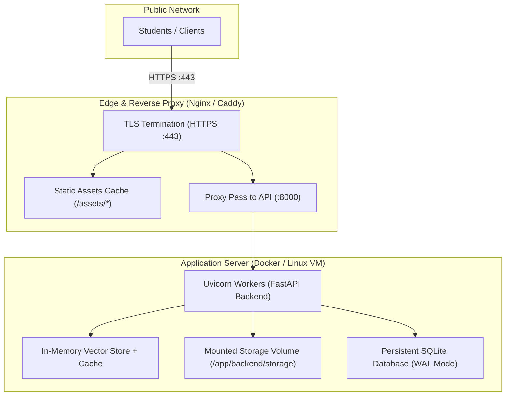

# StudyLens AI — Production Deployment Guide

This guide details deployment options, containerization, reverse proxy configuration, environment hardening, and rollback strategies for **StudyLens AI**.

---

## 1. Supported Deployment Topologies



---

## 2. Docker Deployment (Recommended)

### A. Backend Dockerfile (`backend/Dockerfile`)
```dockerfile
FROM python:3.12-slim

WORKDIR /app

# Install security updates
RUN apt-get update && apt-get install -y --no-install-recommends \
    curl \
    && rm -rf /var/lib/apt/lists/*

# Install dependencies
COPY backend/requirements.txt /app/backend/requirements.txt
RUN pip install --no-cache-dir --upgrade pip && \
    pip install --no-cache-dir -r /app/backend/requirements.txt

# Copy source code
COPY backend /app/backend

# Create storage directories
RUN mkdir -p /app/backend/storage/uploads /app/backend/storage/temp

# Create non-privileged user for security
RUN useradd -u 1001 -m studylens && \
    chown -R studylens:studylens /app
USER studylens

EXPOSE 8000

HEALTHCHECK --interval=30s --timeout=5s --start-period=5s --retries=3 \
  CMD curl -f http://localhost:8000/api/health/ready || exit 1

CMD ["uvicorn", "backend.app.main:app", "--host", "0.0.0.0", "--port", "8000"]
```

### B. Production `docker-compose.yml`
```yaml
version: "3.8"

services:
  backend:
    build:
      context: .
      dockerfile: backend/Dockerfile
    restart: unless-stopped
    ports:
      - "8000:8000"
    environment:
      - ENVIRONMENT=production
      - DEBUG=False
      - JWT_SECRET_KEY=${JWT_SECRET_KEY}
      - CORS_ALLOWED_ORIGINS=https://studylens.yourdomain.com
      - AI_PROVIDER=gemini
      - GEMINI_API_KEY=${GEMINI_API_KEY}
      - GEMINI_MODEL=gemini-2.0-flash
    volumes:
      - studylens_data:/app/backend/storage

  frontend:
    build:
      context: ./frontend
      dockerfile: Dockerfile
    restart: unless-stopped
    ports:
      - "80:80"

volumes:
  studylens_data:
```

---

## 3. Production Hardening Checklist

Before exposing StudyLens AI to public internet traffic, verify every item below:

- [ ] **Environment**: Set `ENVIRONMENT=production`. This automatically disables OpenAPI `/docs` and enables HTTP Strict Transport Security (HSTS).
- [ ] **Debug Disabled**: Set `DEBUG=False` in `.env` to prevent verbose error disclosure.
- [ ] **Strong JWT Secret**: Generate a 64-character random key using `python -c "import secrets; print(secrets.token_urlsafe(64))"`.
- [ ] **Strict CORS**: Set `CORS_ALLOWED_ORIGINS` strictly to your production domain (e.g. `https://studylens.yourdomain.com`). Never use `*`.
- [ ] **HTTPS / TLS Only**: Enforce HTTPS via Let's Encrypt or your cloud load balancer.
- [ ] **Storage Volume Mounted**: Ensure `backend/storage` is mounted to persistent disk storage so uploaded PDFs and databases persist across container restarts.

---

## 4. Nginx Reverse Proxy Configuration

```nginx
server {
    listen 80;
    server_name studylens.yourdomain.com;
    return 301 https://$host$request_uri;
}

server {
    listen 443 ssl http2;
    server_name studylens.yourdomain.com;

    ssl_certificate /etc/letsencrypt/live/studylens.yourdomain.com/fullchain.pem;
    ssl_certificate_key /etc/letsencrypt/live/studylens.yourdomain.com/privkey.pem;

    # Security Headers
    add_header X-Content-Type-Options "nosniff" always;
    add_header X-Frame-Options "DENY" always;
    add_header Referrer-Policy "strict-origin-when-cross-origin" always;

    # Frontend Static Build
    location / {
        root /var/www/studylens/frontend/dist;
        index index.html;
        try_files $uri $uri/ /index.html;
    }

    # Backend API Reverse Proxy
    location /api/ {
        proxy_pass http://127.0.0.1:8000;
        proxy_http_version 1.1;
        proxy_set_header Upgrade $http_upgrade;
        proxy_set_header Connection 'upgrade';
        proxy_set_header Host $host;
        proxy_set_header X-Real-IP $remote_addr;
        proxy_set_header X-Forwarded-For $proxy_add_x_forwarded_for;
        proxy_set_header X-Forwarded-Proto $scheme;
        client_max_body_size 25M;
    }
}
```

---

## 5. Health Monitoring & Rollback Strategy

### Health Probes
- **Liveness Probe**: `GET /api/health` — Verifies the web server is responding.
- **Readiness Probe**: `GET /api/health/ready` — Returns `200 OK` if the database and disk storage are writable; returns `503 Service Unavailable` if dependencies are unavailable.

### Safe Rollback Procedure
If an issue occurs after a release:
1. Revert to the previous stable Git commit:
   ```bash
   git checkout <previous_commit_hash>
   ```
2. Rebuild and restart the containers:
   ```bash
   docker compose build && docker compose up -d
   ```
3. If database schema rollback is required, restore the pre-deployment snapshot:
   ```bash
   cp backend/storage/backup_pre_deploy.db backend/storage/studylens.db
   ```

---

## 6. Related Documentation
- [Environment Variables](ENVIRONMENT_VARIABLES.md)
- [Monitoring & Troubleshooting](MONITORING_AND_TROUBLESHOOTING.md)
- [Security & Threat Model](SECURITY.md)
