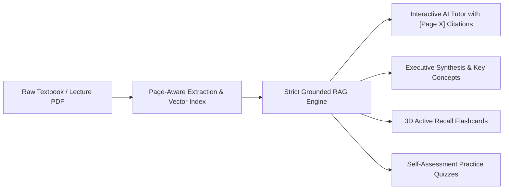

# StudyLens AI — Project Overview

## 1. Project Purpose & Vision

**StudyLens AI** is an intelligent, grounded, and secure academic tutoring platform engineered to help students, researchers, and self-learners master complex study materials.

Instead of generic chatbot answers that hallucinate unsupported facts, StudyLens AI anchors every explanation, study summary, flashcard, and practice quiz directly to verified passages inside uploaded textbooks, lecture notes, and scientific papers with **exact page citations**.

---

## 2. Problems Solved

| Problem in Existing AI Tutors | How StudyLens AI Solves It |
| :--- | :--- |
| **Hallucination of Facts** | Explanations are restricted strictly to retrieved document passages. If evidence is missing, the tutor explicitly states it cannot find the information. |
| **Missing Provenance & Citations** | Every claim cites the specific source page (e.g. `[Page 4]`). Clicking citations instantly flashes the cited excerpt in the document viewer. |
| **Data Privacy & Tenant Commingling** | Multi-tenant isolation ensures User A's private documents and vector embeddings can never be queried, retrieved, or accessed by User B. |
| **Passive vs. Active Learning** | Transforms passive reading into active recall through automatic flashcards, self-assessment practice quizzes, and structured takeaways. |
| **Denial of Service & File Vulnerabilities** | Defends against malicious PDF bombs, path traversal attacks, and prompt injections embedded in uploaded documents. |

---

## 3. Target Audience & Core Personas

1. **University Students**: Reviewing dense engineering, medical, or humanities textbooks before midterms and finals.
2. **Researchers & Academics**: Quickly digesting multi-page PDF papers, isolating methodologies, and extracting key findings with page attribution.
3. **Professional Certification Candidates**: Studying for exams (AWS, CPA, Bar Exam, USMLE) with active recall flashcards and practice quizzes.

---

## 4. Key User Journeys

### Journey 1: Grounded Tutoring & Verification
1. The student logs into their private workspace (protected by Argon2id).
2. The student uploads a 20-page lecture PDF.
3. The server validates magic bytes, extracts page-wise text, and indexes embeddings into an isolated vector partition.
4. The student asks: *"What is the difference between supervised and unsupervised learning?"*
5. The tutor returns an explanation citing `[Page 3]`.
6. The student clicks `[Page 3]`: the reader switches to Page 3 and highlights the verbatim passage with a warm citation flash.

### Journey 2: Self-Assessment & Exam Preparation
1. The student switches to the **Flashcard Studio**:
   - Reviews cards with realistic 3D flip animations using keyboard shortcuts (`Space` to flip, `ArrowRight` to advance).
   - Marks difficult cards as *Mastered* (`M` key) to track study progress.
2. The student switches to the **Practice Quiz**:
   - Answers multiple-choice questions (A, B, C, D).
   - Receives instant visual feedback (sage green for correct, crimson for incorrect) with grounded explanations linking to source pages.

---

## 5. Scope & Current Limitations

### Current Supported Scope
- PDFs up to 20 MB and 100 pages containing selectable text.
- Full multi-tenant isolation with JWT authentication and session blocklists.
- In-memory vector store with automatic database cold-start recovery.
- Offline mock AI provider for zero-cost testing, plus production Google Gemini API integration.
- Desktop and responsive mobile layout.

### Explicit Limitations (Transparently Documented)
- Scanned image PDFs without embedded OCR text are rejected with a clear error prompt (OCR extraction pipeline is planned for v1.2).
- Single-instance SQLite deployment (suitable for tens of concurrent users, see [Scalability & Performance](SCALABILITY_AND_PERFORMANCE.md) for PostgreSQL migration path).
- Local storage for uploaded files (cloud S3/GCS bucket storage abstraction is detailed in [Deployment](DEPLOYMENT.md)).

---

## 6. Related Documentation
- [System Architecture](ARCHITECTURE.md)
- [Technology Stack](TECH_STACK.md)
- [Security Engineering](SECURITY.md)
- [API Reference](API.md)
