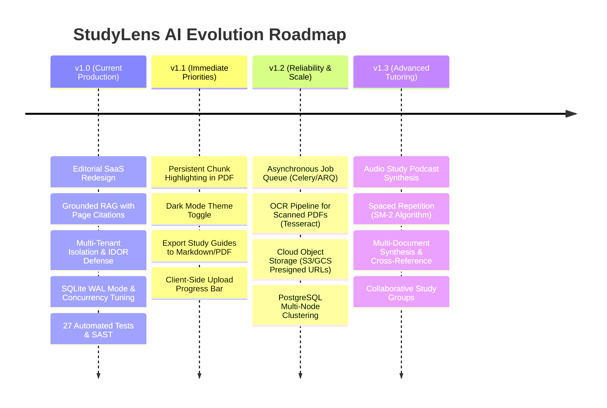

# StudyLens AI — Product & Technical Roadmap

This roadmap transparently outlines the current production-ready capabilities of **StudyLens AI**, along with scheduled engineering milestones for upcoming releases.

---

## 1. Release Milestone Overview

---

## 2. Milestone Details

### v1.0 — Current Production Release (Completed)
- [x] **Editorial SaaS Redesign**: Warm paper palette (`#F8F7F4`), typography hierarchy (`Newsreader` serif, `Inter` sans, `JetBrains Mono`), and elimination of generic AI neon tropes.
- [x] **Page-Aware PDF Viewer**: Split-screen reading canvas with dynamic font sizing (`A`, `A+`) and `.citation-flash` highlight animation.
- [x] **Grounded AI Tutor**: Context-bounded RAG answering with interactive `[Page X]` citation pills linking directly to reader passages.
- [x] **Active Recall Flashcard Studio**: 3D CSS perspective card flip with mastery tracking and desktop keyboard shortcuts (`Space`, `Arrows`, `M`).
- [x] **Self-Assessment Practice Quiz**: Multiple-choice testing with instant sage green/crimson feedback and source page citations.
- [x] **Multi-Tenant Security**: Argon2id password hashing, signed JWTs with `jti` blocklisting, and server-side IDOR checks.
- [x] **Concurrency & Durability**: SQLite WAL mode with 30s busy timeout, vector store cold-start recovery, and tenant-isolated query cache.
- [x] **Quality Release Gates**: 27 automated tests passing 100%, Bandit SAST clean (0 issues), and strict TypeScript build.

---

### v1.1 — Immediate Priorities
- [ ] **Direct Canvas PDF Annotation**: In-line yellow text highlighting directly on rendered canvas pages in addition to textual excerpts.
- [ ] **Dark Mode Editorial Theme**: High-contrast, low-fatigue slate/sepia reading theme for night studying.
- [ ] **Export Study Guides**: One-click export of executive summaries, flashcard decks, and quiz sets to Markdown and printable PDF.
- [ ] **Upload Progress Bar**: Chunk-by-chunk client upload progress tracking for large multi-megabyte files.

---

### v1.2 — Reliability, Scale & Background Jobs
- [ ] **Asynchronous Task Queue**: Offload PDF text extraction and embedding generation to an asynchronous background worker (ARQ or Celery with Redis) with a job status endpoint (`GET /api/jobs/{id}`).
- [ ] **Optical Character Recognition (OCR)**: Integrate Tesseract / AWS Textract to extract text from scanned photocopies and textbook images.
- [ ] **Cloud Object Storage**: Abstract file storage to support AWS S3 or Google Cloud Storage using presigned URLs, decoupling file storage from local server disks.
- [ ] **Managed PostgreSQL Migration**: Provide a one-command Docker Compose deployment for PostgreSQL + pgvector for distributed multi-instance clusters.

---

### v1.3 — Advanced AI & Spaced Repetition
- [ ] **SuperMemo-2 (SM-2) Spaced Repetition**: Intelligent flashcard scheduling based on user mastery ratings, prompting students to review cards right before forgetting.
- [ ] **Multi-Document Synthesis**: Cross-document querying across entire course semester folders (e.g. asking a question answered across Lectures 1 through 5).
- [ ] **Audio Notebooks / Podcasts**: Convert textbook summaries into natural audio study podcasts for mobile listening.

---

## 3. Related Documentation
- [Project Overview](PROJECT_OVERVIEW.md)
- [System Architecture](ARCHITECTURE.md)
- [Scalability & Performance Analysis](SCALABILITY_AND_PERFORMANCE.md)
